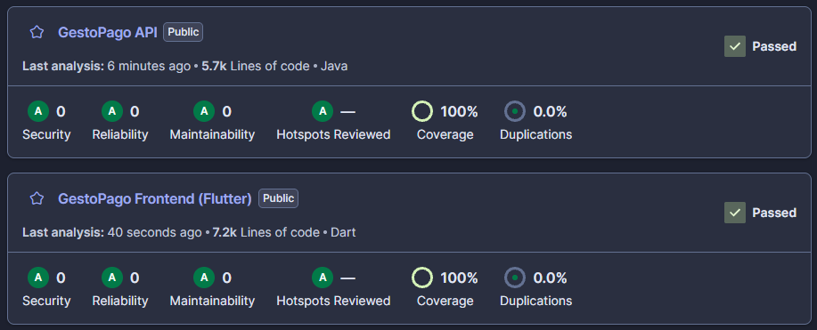

# GestoPago · Frontend (web y móvil)

Dos aplicaciones Flutter que comparten un solo código y consumen la misma API REST (Spring Boot). No duplican lógica de negocio: validan solo para guiar al usuario y el servidor decide siempre.

| Aplicación | Punto de entrada | Marco de navegación |
|---|---|---|
| Web | `lib/main_web.dart` | Barra lateral en pantallas anchas; barra inferior en ventanas angostas |
| Móvil | `lib/main_mobile.dart` | Barra inferior; riel lateral en tabletas horizontales |

## Ejecutar

```bash
flutter pub get
```

```bash
flutter run -d chrome -t lib/main_web.dart --dart-define=API_BASE_URL=http://localhost:8080
```

```bash
flutter run -t lib/main_mobile.dart --dart-define=API_BASE_URL=http://10.0.2.2:8080
```

`10.0.2.2` es el `localhost` del equipo visto desde el emulador de Android. Para producción compila con una URL `https://`:

```bash
flutter build web -t lib/main_web.dart --dart-define=API_BASE_URL=https://api.tu-dominio.com
```

La API debe permitir el origen de la web: variable `CORS_ORIGENES` de la API (por defecto `http://localhost:*`, `http://127.0.0.1:*`).

## Arquitectura

Screaming architecture (la estructura dice qué hace la app) con puertos y adaptadores dentro de cada módulo:

```
lib/
├── authentication/   Registro, iniciar y cerrar sesión, sesión vigente
├── productos/        Catálogo y detalle
├── pagos/            Compra, resultado, historial
├── perfil/           Datos del cliente, cuentas bancarias y PIN
│   ├── domain/
│   │   ├── entities/        Modelos del negocio (sin Flutter ni HTTP)
│   │   └── ports/           Puertos de salida: interfaces que el dominio necesita
│   ├── application/         Casos de uso y controladores (ChangeNotifier)
│   └── infraestructure/
│       ├── adapters/        Adaptadores de salida: HTTP, almacenamiento seguro
│       └── ui/              Adaptadores de entrada: pantallas y widgets
├── core/             Núcleo compartido: cliente HTTP, errores, tema, formato
├── app/              Raíz de composición, rutas y marcos web/móvil
├── main_web.dart
└── main_mobile.dart
```

- `app/dependencias.dart` es el único lugar donde un puerto se une a su adaptador. Las pruebas pueden sustituir cualquier adaptador.
- `productos` no depende de `pagos`: la acción de compra se inyecta en la pantalla del catálogo como un widget.
- Sin animaciones: transiciones de página desactivadas y sin efectos de entrada.

## Seguridad

| Requisito | Cómo se cumple |
|---|---|
| HTTPS | La URL base se define al compilar (`API_BASE_URL`). Una compilación de producción con HTTP hacia un host que no sea el propio equipo se niega a arrancar. |
| Autenticación | Acceso en dos pasos: contraseña (`/auth/login`) y código de 6 dígitos de una app autenticadora (TOTP: Google Authenticator, Microsoft Authenticator, Authy) (`/auth/verificar`); la primera vez la pantalla muestra el QR (`qr_flutter`) y la clave para enlazarla; el servidor valida ambos. El JWT resultante se envía como `Authorization: Bearer`. |
| Control de acceso | `redirect` del enrutador: sin sesión solo existe `/login`. El servidor valida cada petición. |
| Sesión única | Si el usuario ya tiene sesión en otro dispositivo (web o móvil), el servidor responde `409`; la app pide confirmar y reenvía el código con `cerrarSesionAnterior: true`. La sesión desplazada vuelve al login con el motivo en máximo 10 s, aunque el usuario no esté navegando: la app consulta `GET /auth/sesion` cada 10 s y al volver a la app o pestaña. |
| Expiración de sesión | El token trae `expiraEnMs`; un temporizador cierra la sesión al vencer. Además se cierra tras 15 min sin interacción (`GuardiaInactividad`). Un `401` en cualquier ruta protegida también la cierra. |
| Cierre de sesión | Llama a `/auth/logout` (el JWT queda revocado en el servidor) y borra el token del dispositivo y los datos en memoria (catálogo, historial). Si no hay red, igual se cierra localmente. |
| Credenciales | Token en `flutter_secure_storage`; la contraseña y el PIN no se guardan, no se registran y los campos los ocultan. |
| Validación | Formato de correo, celular, referencia, monto y PIN antes de enviar; el servidor vuelve a validar. |
| Errores | Se muestra el campo `mensaje` de la API (ya redactado para el usuario); los errores 5xx y de red usan textos genéricos. |

### Limitaciones

- **Imágenes de productos**: el catálogo de GestoPago (`GET /productos`) no incluye imágenes ni URL de imagen. Cada servicio se identifica con un monograma estable (iniciales y color derivados de su nombre).

## Integración con la API

Contrato general de respuesta: `{ "codigo": 0|1, "mensaje": "...", "datos": ... }`. Los errores devuelven `codigo: 1` y el `mensaje` explica el motivo. El cliente HTTP (`core/network/api_client.dart`) desenvuelve este formato para todos los adaptadores.

### Autenticación

| | |
|---|---|
| Paso 1 | `POST /auth/login` (público) · `{ "correo", "password" }` → `datos: { desafioId, expiraEnMs, enrolamiento }` (`enrolamiento` = `{ secreto, otpauthUri }`, solo mientras la app no está enlazada). 401 credenciales incorrectas · 403 inactivo · 429 demasiados intentos |
| Paso 2 | `POST /auth/verificar` (público) · `{ "desafioId", "codigo", "cerrarSesionAnterior" }` → `datos: { token, tipo, expiraEnMs, usuario, nombreCompleto }`. 401 código incorrecto/vencido · 409 hay otra sesión activa · 429 demasiados intentos |
| Cierre | `POST /auth/logout` (Bearer) → 200; revoca la sesión en el servidor |
| Sondeo de sesión | `GET /auth/sesion` (Bearer) → 200 sesión activa · 401 cerrada, vencida o reemplazada por otro dispositivo (la app cierra la sesión). Se llama cada 10 s y al volver a la app; un fallo de red no cierra la sesión |
| Validación en la app | Correo con formato válido (máx. 100); contraseña obligatoria (máx. 72); código de exactamente 6 dígitos |
| Adaptador | `authentication/infraestructure/adapters/api_autenticacion_gateway.dart` |

### Registro

| | |
|---|---|
| Disponibilidad | `POST /clientes/disponibilidad` (público) · `{ curp?, rfc?, telefonoMovil?, correoElectronico? }` → `datos: { duplicados: [campos que ya tienen cuenta] }`. Se consulta en cada paso del formulario para avisar por campo |
| Alta | `POST /clientes` (público) · datos personales, empresa, domicilio, `correoElectronico` y `password` → 201 cliente creado con su cuenta en saldo 0 |
| Errores | 400 datos inválidos · 409 CURP, RFC, teléfono o correo ya registrados (el mensaje nombra cuáles) · 429 demasiados registros |
| Validación en la app | CURP, RFC, nombres, teléfono de 10 dígitos, código postal de 5, mayoría de edad y contraseña segura antes de enviar |
| Adaptador | `authentication/infraestructure/adapters/api_registro_gateway.dart` |

### Catálogo

| | |
|---|---|
| Endpoint | `GET /productos` (Bearer) |
| Respuesta 200 | `datos: { total, productos: [{ producto, servicio, idServicio, idProducto, idCatTipoServicio, tipoFront, hasDigitoVerificador, tipoReferencia, precio, showAyuda, legend }] }` |
| Errores | 401 sesión inválida · 502 proveedor no disponible |
| Adaptador | `productos/infraestructure/adapters/api_catalogo_repository.dart` |

Cómo se interpreta cada producto (`productos/domain/entities/producto.dart`):

| `tipoFront` | Operación | Significado de `precio` |
|---|---|---|
| 1 | Recarga | Precio fijo; el monto enviado debe ser igual. Si `precio` es 0 o nulo, no se puede comprar. |
| 1 con `idCatTipoServicio` 10 u 11 | Código canjeable | Precio fijo; no pide celular. |
| 2 | Pago de servicio | Comisión que se suma al monto que indica el usuario. |
| Otros (p. ej. 4, consulta) | No disponible | — |

Las categorías de la interfaz (Recargas, Tarjetas y códigos, Pago de servicios, Otros) se derivan de esa tabla porque la API no entrega nombres de categoría.

### Cuentas

| | |
|---|---|
| Endpoint | `POST /cuentas/consultar` (Bearer) |
| Cuerpo | `{ "activo": true, "pagina": 0, "tamanio": 20 }` |
| Respuesta 200 | `datos: { datos: [{ id, numeroCuenta, saldo, estaActiva, ... }], pagina, totalPaginas, ... }` |
| Uso | Cuenta de origen y saldo para validar antes de pagar |
| Adaptador | `pagos/infraestructure/adapters/api_cuentas_repository.dart` |

### Compra

| | |
|---|---|
| Endpoint | `POST /pagos` (Bearer) |
| Cuerpo | `{ numeroCuenta (18 dígitos), idProducto, idServicio, monto (≥0.01, 2 decimales), telefono? (10 dígitos), referencia? (alfanumérica 1–100), pinAutorizacion (4–6 dígitos) }`. Un campo extra se rechaza. |
| Respuesta 200 | `datos: { estado, idTx, numAutorizacion, monto, comision, referencia, saldoDisponible, fecha, pin?, legend? }` |
| Tiempo de espera | 85 s (el servidor puede tardar hasta ~70 s) |
| Adaptador | `pagos/infraestructure/adapters/api_pagos_repository.dart` |

Cada respuesta se clasifica en `pagos/application/realizar_compra.dart`:

| Resultado en pantalla | Cuándo | Qué dice la app |
|---|---|---|
| **Compra exitosa** (recibo) | 200 y `estado == "APROBADO"` | Muestra el recibo. Es el único caso que cuenta como compra realizada. |
| **Compra rechazada** | 400, 403 (PIN), 404, 409 (duplicado), 422 (saldo o rechazo), 423 (PIN bloqueado), 429 (límite), 503 | Muestra el mensaje del servidor y que no hubo cargo. Permite corregir y reintentar. |
| **Compra pendiente** | 504 (pago en revisión), o 200 con otro estado | El saldo está retenido; no se debe repetir el pago. Extrae la referencia del mensaje y permite consultar su estado. |
| **Error de comunicación** | 502 (proveedor sin recibir el pago, sin cargo) · otros 5xx, sin red o tiempo agotado (resultado **incierto**) | Si es incierto, indica revisar el historial antes de reintentar. |

Un 401 cierra la sesión.

### Consulta de estado de un pago

| | |
|---|---|
| Endpoint | `POST /pagos/consulta` (Bearer) |
| Cuerpo | `{ "upc": "15 caracteres A-Z0-9" }` |
| Respuesta 200 | `datos: { upc, estado, mensaje, monto, comision, referencia, idTx?, numAutorizacion? }` con `estado` PENDIENTE, EN_REVISION, APROBADO o RECHAZADO |
| Errores | 400 formato · 404 no existe o es de otro usuario |

### Historial de compras

| | |
|---|---|
| Endpoint | `POST /pagos/historial` (Bearer) — **agregado al backend para este frontend** |
| Cuerpo | `{ "pagina": 0, "tamanio": 20 }` (`pagina` ≥ 0; `tamanio` de 1 a 100). Un campo extra o un valor fuera de rango responde 400 |
| Respuesta 200 | `datos: { datos: [{ upc, estado, producto, servicio, idProducto, idServicio, monto, comision, total, referencia, telefono, idTx, numAutorizacion, fecha }], pagina, tamanoPagina, totalElementos, totalPaginas }` |
| Contenido | Pagos del usuario autenticado en cualquier estado, del más reciente al más antiguo; `tamanio` máx. 100. La app los separa con un filtro (Todos, Aprobados, En proceso, Rechazados) y solo los `APROBADO` se presentan como compras realizadas con su recibo |
| Adaptador | `ApiPagosRepository.historial` |

### Perfil y cuentas

| | |
|---|---|
| Usuario | `GET /usuarios/me` (Bearer) → `datos: { clienteId, correo, ... }` |
| Datos del cliente | `POST /clientes/consultar` (Bearer) · `{ correo, pagina: 0, tamanio: 5 }` → lista paginada; la app toma el cliente con el `clienteId` de `/usuarios/me` (a un administrador la consulta le devuelve varios) |
| Editar | `PATCH /clientes` (Bearer) · `{ identificacion: { rfc }, cambios: { solo campos modificados } }` → `datos: ClienteResponse`. CURP, RFC y teléfono móvil son de solo lectura |
| PIN de pagos | `PUT /cuentas/pin` (Bearer) · `{ numeroCuenta, pinActual?, pinNuevo }` (4–6 dígitos; `pinActual` solo si ya tenía PIN) |
| Errores | 400 datos inválidos · 403 PIN actual incorrecto · 409 dato repetido · 423 PIN bloqueado |
| Adaptador | `perfil/infraestructure/adapters/api_perfil_repository.dart` |

## Cambios en el backend

1. `POST /pagos/historial` (historial): `PagoController`, `HistorialPagoRequest`, `PagoService`, `PagoRegistroService`, `PagoRepository` y `HistorialPagoResponse`. El nombre del producto sale del catálogo local.
2. CORS configurable en `SecurityConfiguration` (antes estaba deshabilitado y el navegador bloqueaba a la web).
3. `POST /clientes/disponibilidad`: avisa por campo de los datos repetidos durante el registro.
4. `GET /auth/sesion`: permite a las apps detectar en segundos que otro dispositivo cerró la sesión.

## Pruebas

```bash
flutter analyze
```

```bash
flutter test
```

Resultado de SonarQube (frontend y backend): 100 % de cobertura, 0 vulnerabilidades y Quality Gate aprobado. Se repite con `powershell -File scripts/sonar-frontend.ps1` desde la raíz del repositorio.


